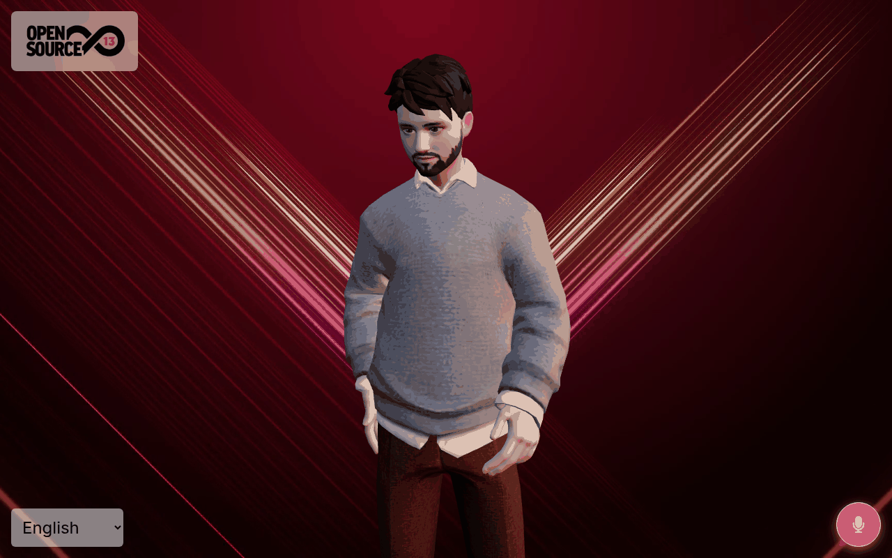
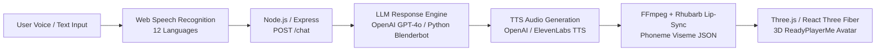
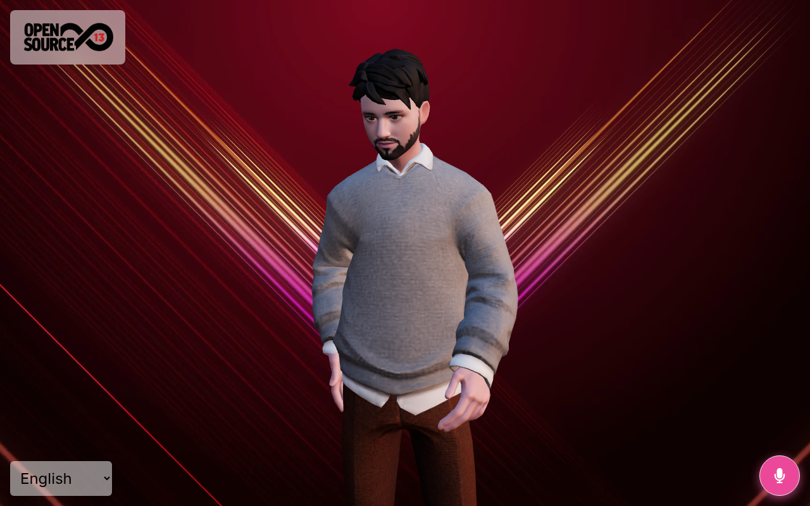
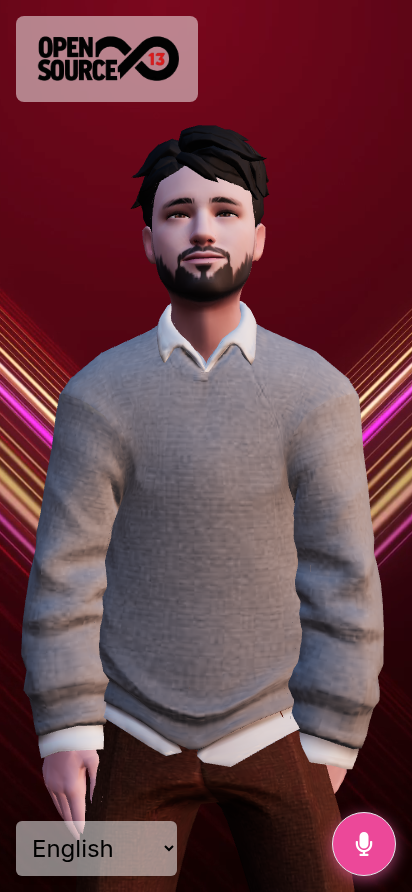

# 3D Multilingual Avatar Chatbot — Virtual Friend


An interactive **3D AI Virtual Assistant** rendered in WebGL with React Three Fiber and ReadyPlayerMe avatars. Users can speak in 12 languages via browser speech recognition and receive expressive, lip-synced 3D responses backed by conversational AI, Text-to-Speech (TTS), and Rhubarb Lip Sync.

> **Project Status:** Completed academic / open-source 1337 (42 Network) project (`OPEN SOURCE 13`). Source code is maintained locally with automated frontend build & backend syntax CI checks.

---

## Live 3D Avatar Demo



---

## Architecture & Conversation Pipeline



### How It Works
1. **Multilingual Voice Capture ([UI.jsx](open-source-chatbot-V13-frontend/src/components/UI.jsx))**: Captures speech in 12 selectable languages (`en-US`, `fr-FR`, `ar-SA`, `es-ES`, `de-DE`, `it-IT`, `ja-JP`, `ko-KR`, `pt-BR`, `ru-RU`, `zh-CN`, `tr-TR`) using the Web Speech API.
2. **Backend Orchestration ([index.js](open-source-chatbot-V13-backend/index.js) & [content.js](open-source-chatbot-V13-backend/content.js))**: Receives messages on `POST /chat`, maintains session conversation history, detects language via `franc`, and selects facial expressions (`smile`, `sad`, `angry`, `shocked`, `thinking`, `default`) plus 3D skeletal animations (`Talking_1`–`Talking_4`, `Greeting`, etc.).
3. **Local AI Helpers ([local_model.py](open-source-chatbot-V13-backend/local_model.py) & [Transcribe.py](open-source-chatbot-V13-backend/Transcribe.py))**: Experimental scripts for offline response generation with `facebook/blenderbot-400M-distill` and multilingual speech transcription with OpenAI Whisper.
4. **Audio + Lip-Sync Generation**: Converts TTS MP3 responses to WAV via `ffmpeg`, generates timed mouth cues with Rhubarb Lip Sync (including phonetic Arabic support), and streams base64 audio + viseme JSON to the client.
5. **Real-Time 3D Rendering ([Avatar.jsx](open-source-chatbot-V13-frontend/src/components/Avatar.jsx) & [Experience.jsx](open-source-chatbot-V13-frontend/src/components/Experience.jsx))**: Smoothly blends ReadyPlayerMe blendshapes (`viseme_PP`, `viseme_kk`, `viseme_I`, `viseme_AA`, `viseme_O`, `viseme_U`, `viseme_FF`, `viseme_TH`), blinking, and skeletal clips in real time.

---

## Screenshots

| Desktop 3D Avatar & Controls | Responsive Mobile View |
| :---: | :---: |
|  |  |

---

## Project Structure

```text
chatbot-open-source-v13/
├── .github/
│   └── workflows/
│       └── ci.yml                       # Frontend build + backend syntax CI
├── docs/
│   └── images/                          # README screenshots & demo GIF
├── open-source-chatbot-V13-frontend/    # React + Vite + Three.js client
│   ├── public/
│   │   ├── animations/
│   │   │   └── animations.glb           # Combined Mixamo/RPM skeletal animations
│   │   ├── models/                      # ReadyPlayerMe 3D avatars (Victor, Alex, Dayo, etc.)
│   │   ├── bg.mp4 / bg1.mp4             # Ambient video backgrounds
│   │   └── logo.png                     # Branding overlay
│   ├── src/
│   │   ├── components/
│   │   │   ├── Avatar.jsx               # Viseme lip-sync, facial morphs & animation mixer
│   │   │   ├── Experience.jsx           # CameraControls, HDRI lighting & 3D scene
│   │   │   └── UI.jsx                   # 12-language selector & voice recognition trigger
│   │   ├── hooks/
│   │   │   └── useChat.jsx              # Chat context, queue state & backend API client
│   │   └── App.jsx                      # Canvas & UI root layout
│   ├── .env.example
│   └── package.json
├── open-source-chatbot-V13-backend/     # Express server & speech/AI scripts
│   ├── audios/                          # Sample MP3/WAV responses & Rhubarb JSON cues
│   ├── index.js                         # /chat endpoint, OpenAI/TTS & Rhubarb pipeline
│   ├── content.js                       # System prompt / persona definition
│   ├── local_model.py                   # Offline Blenderbot-400M dialogue generator
│   ├── Transcribe.py                    # Offline Whisper audio transcription script
│   ├── .env.example
│   └── package.json
├── .gitignore
└── LICENSE                              # MIT License
```

---

## Getting Started

### Prerequisites
- **Node.js** 18+ and **npm**
- **Python** 3.10+ (optional, for `local_model.py` / `Transcribe.py`)
- **FFmpeg** and **Rhubarb Lip Sync** binary in `open-source-chatbot-V13-backend/bin/rhubarb` (required for live backend lip-sync generation)
- OpenAI / ElevenLabs API key(s) configured in backend `.env`

### 1. Clone the Repository
```bash
git clone https://github.com/M-MAJIDI/chatbot-open-source-v13.git
cd chatbot-open-source-v13
```

### 2. Backend Setup
```bash
cd open-source-chatbot-V13-backend
cp .env.example .env
# Edit .env and add OPENAI_API_KEY / ELEVEN_LABS_API_KEY
npm install
npm run dev
```
The backend server listens on `http://localhost:3000` by default (`PORT` configurable).

### 3. Frontend Setup
```bash
cd ../open-source-chatbot-V13-frontend
cp .env.example .env
# Optional: update VITE_BACKEND_URL in .env (defaults to http://localhost:3000)
npm install
npm run dev
```
Open the URL printed by Vite (typically `http://localhost:5173`) in Chromium or Chrome for full Web Speech API support.

---

## Configuration

| Variable | Location | Default | Description |
| :--- | :--- | :--- | :--- |
| `OPENAI_API_KEY` | `open-source-chatbot-V13-backend/.env` | — | OpenAI Chat & TTS API key |
| `ELEVEN_LABS_API_KEY` | `open-source-chatbot-V13-backend/.env` | — | ElevenLabs voice synthesis API key |
| `PORT` | `open-source-chatbot-V13-backend/.env` | `3000` | Express server port |
| `VITE_BACKEND_URL` | `open-source-chatbot-V13-frontend/.env` | `http://localhost:3000` | Backend base URL used by `useChat.jsx` |

---

## License

This project is licensed under the [MIT License](LICENSE).
